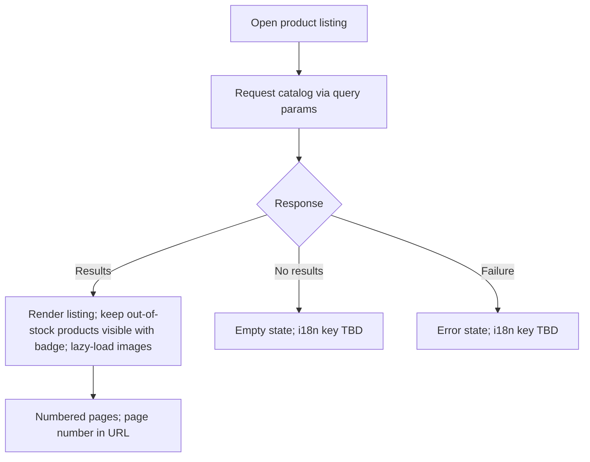
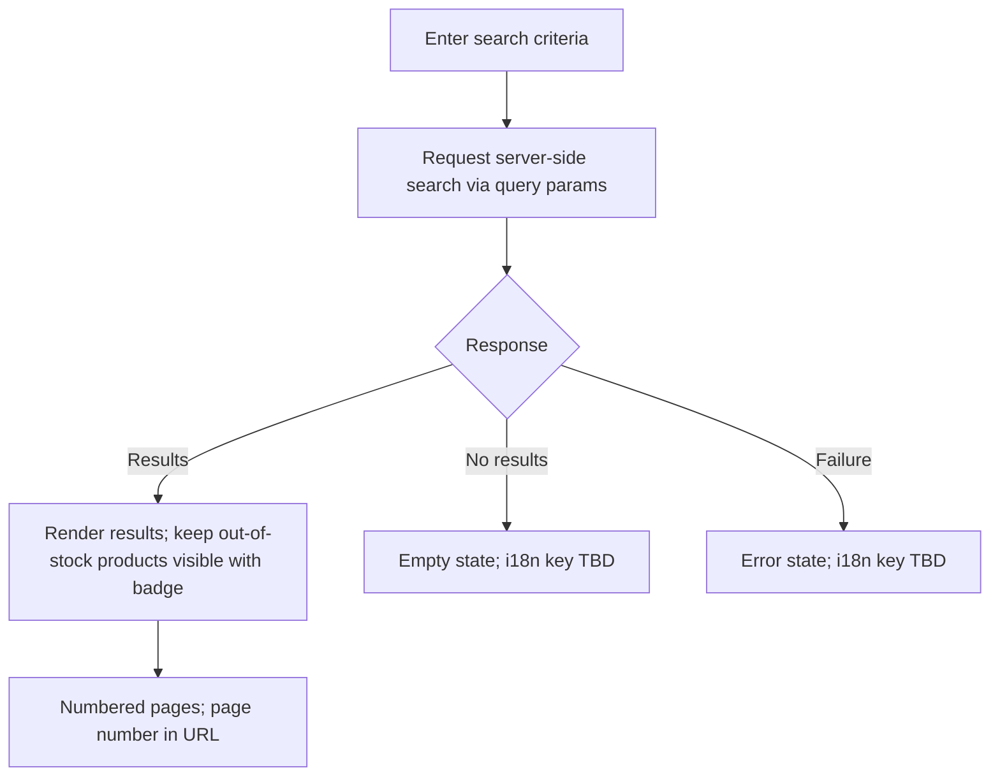
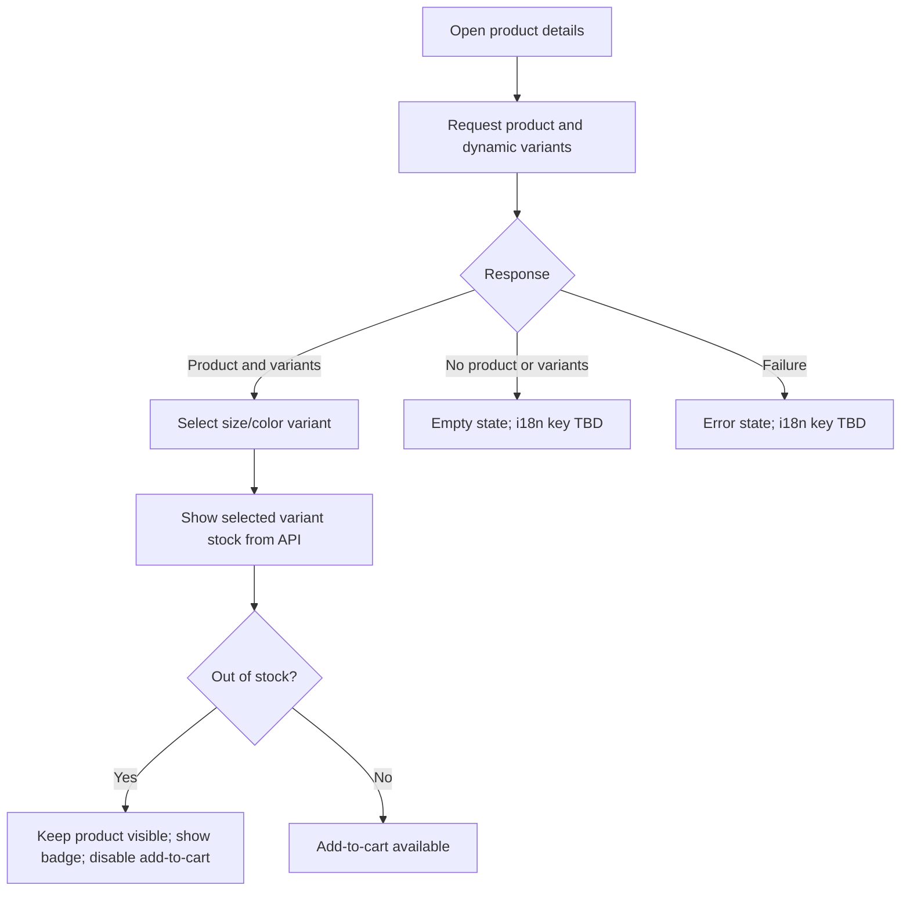
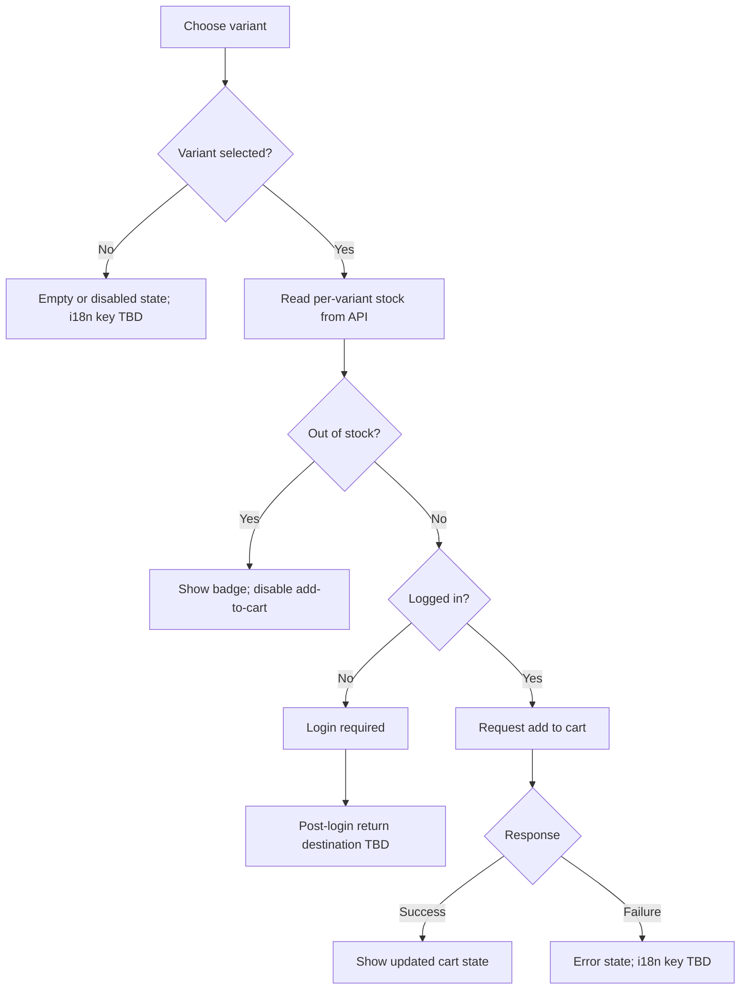
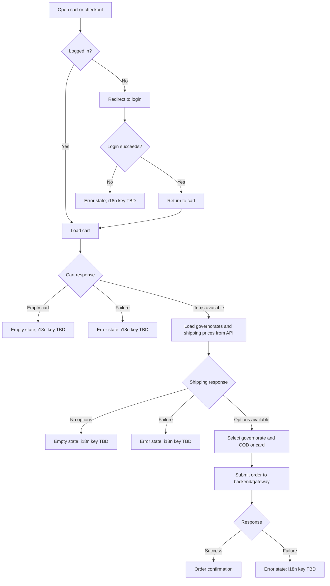
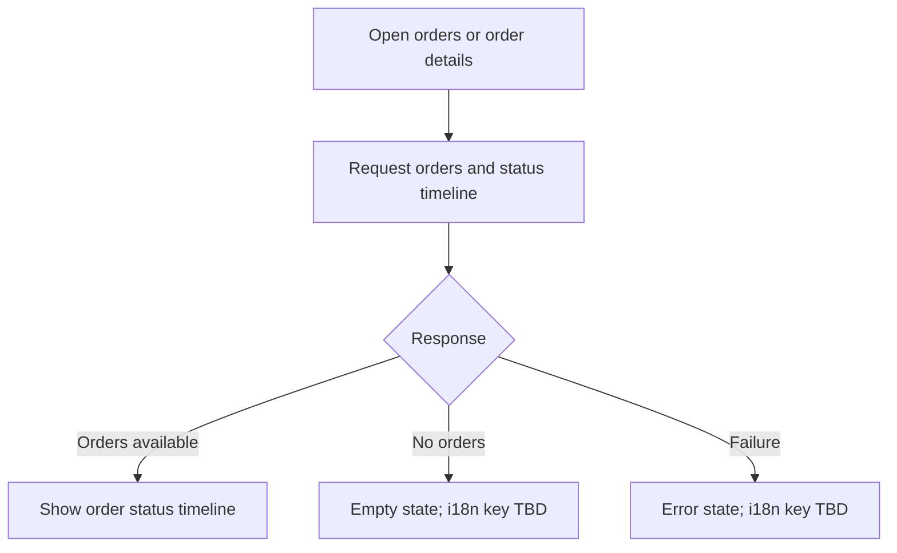
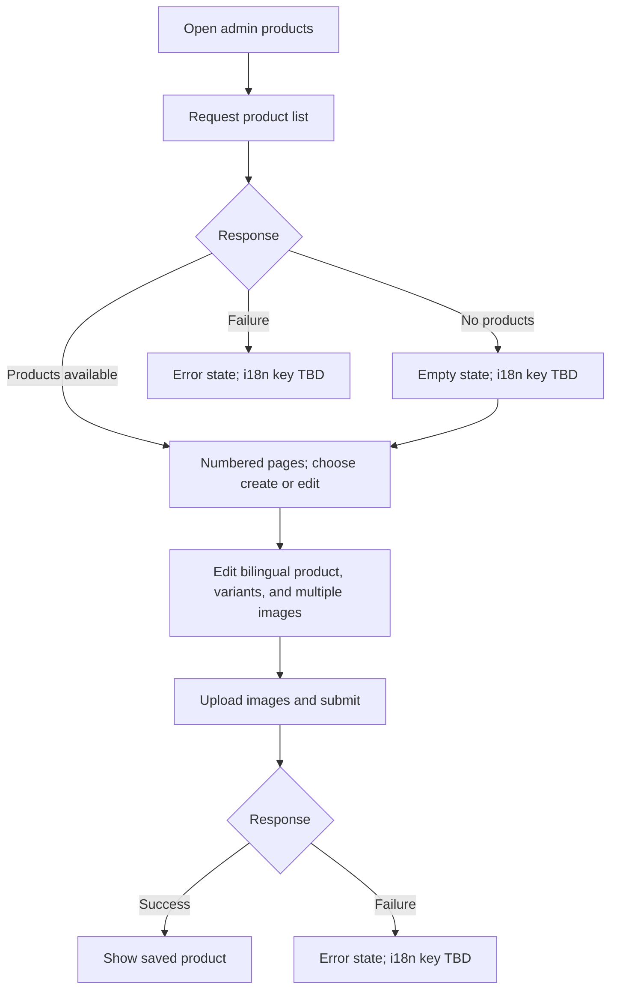
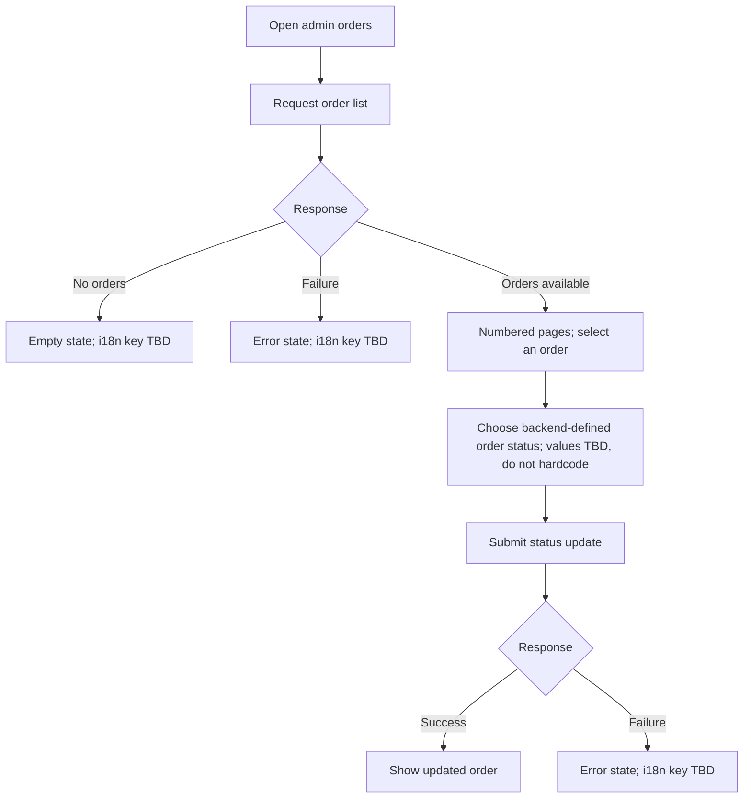
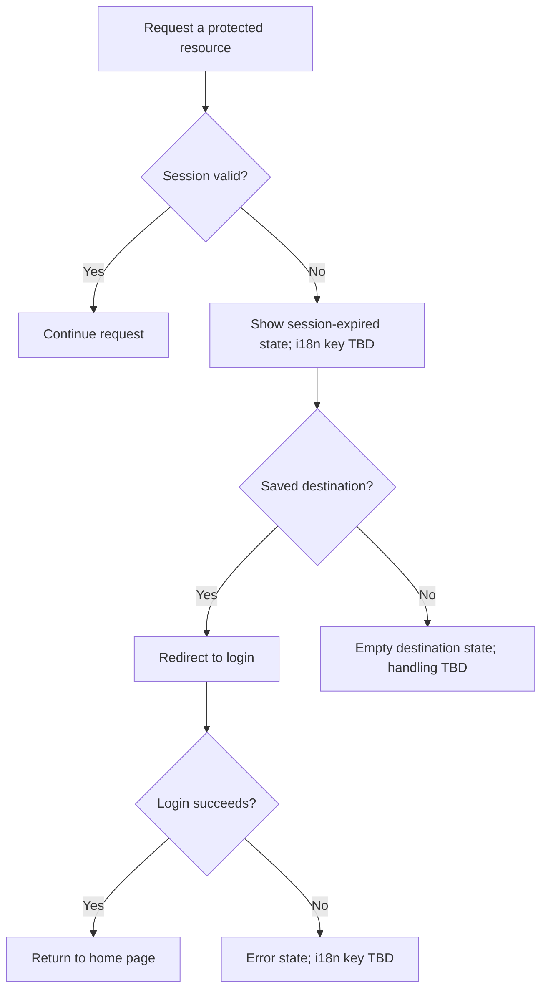

# UX Flows & Interface Design

## A. Page inventory

### Customer pages

| Page | Route path | Auth | Purpose |
|---|---|---|---|
| Home | `/` | TBD | Store entry page. |
| Product listing | `/products` | TBD | Browse the catalog. |
| Search results | `/search` | TBD | View catalog search results. |
| Product details | `/products/:id` | TBD | View product images, variants, stock, and reviews. |
| Cart | `/cart` | Logged-in | Review selected items before checkout. |
| Checkout | `/checkout` | Logged-in | Submit an order with shipping and payment selection. |
| Order confirmation | `/order-confirmation` | TBD | View order confirmation. |
| Login | `/login` | TBD | Sign in. |
| Register | `/register` | TBD | Create an account. |
| Forgot/reset password | `/forgot-password`, `/reset-password` | TBD | Request or complete a password reset. |
| Account overview | `/account` | TBD | View account overview. |
| Profile | `/account/profile` | TBD | View or edit profile details. |
| Addresses | `/account/addresses` | TBD | Manage addresses. |
| Orders list | `/account/orders` | TBD | Browse orders. |
| Order details | `/account/orders/:id` | TBD | View an order and its status timeline. |
| About | `/about` | TBD | View about content. |
| Contact | `/contact` | TBD | View contact content. |
| Policies | `/policies` | TBD | View policy content. |
| 404 | `*` | TBD | Show an unavailable page response. |
| Access denied | `/access-denied` | TBD | Show an access-denied response. |

### Admin pages

| Page | Route path | Auth | Purpose |
|---|---|---|---|
| Dashboard | `/admin/dashboard` | Admin | View new orders, total sales, low stock, and recent orders. |
| Products list | `/admin/products` | Admin | Browse products. |
| Product create | `/admin/products/new` | Admin | Create a product with variants and images. |
| Product edit | `/admin/products/:id/edit` | Admin | Edit a product with variants and images. |
| Categories | `/admin/categories` | Admin | Manage categories. |
| Orders list | `/admin/orders` | Admin | Browse orders. |
| Order details | `/admin/orders/:id` | Admin | View and process an order. |
| Content pages | `/admin/content` | Admin | Manage Arabic and English content pages. |
| Reviews moderation | `/admin/reviews` | Admin | Hide or delete reviews. |

## B. User flows

- Catalog pagination is numbered and keeps the page number in the URL; admin tables use numbered pages.

### Browse


### Search


### Product details and variant selection


### Add to cart


### Checkout


### Order tracking


### Leave a review

```mermaid
flowchart TD
  A[Open product reviews] --> B[Backend checks verified-buyer status]
  B -->|Not verified| C[Show non-buyer message; i18n key TBD]
  B -->|Verified| D[Show review form]
  D --> E{Review submitted?}
  E -->|No review content| F[Empty state; i18n key TBD]
  E -->|Submit| G{Response}
  G -->|Accepted| H[Show review immediately]
  G -->|Failure| I[Error state; i18n key TBD]
```


### Admin: manage product


### Admin: process order


### Session expired


## C. Wireframes

- Draft structures for review, not approved layout decisions; design images from Phase 04 onward take precedence for layout.
- Bracketed phrases identify UI elements, not literal copy. Visible text uses i18n keys; unknown content and fields remain TBD.

### Home

**Desktop**
```text
+----------------------------------------------------+
| [Language toggle] [Navigation TBD]                 |
+----------------------------------------------------+
| [Home content section TBD]                         |
|                                                    |
+----------------------------------------------------+
| [Home content section TBD]                         |
+----------------------------------------------------+
```

**Mobile**
```text
+--------------------------+
| [Language toggle]        |
| [Navigation TBD]          |
+--------------------------+
| [Home content TBD]        |
+--------------------------+
| [Home content TBD]        |
+--------------------------+
```

- RTL: mirror horizontal header/navigation alignment; keep content reading order RTL.

### Product listing

**Desktop**
```text
+----------------------------------------------------+
| [Language toggle] [Navigation TBD]                 |
+----------------------------------------------------+
| [i18n key: search]                                 |
+--------------------+-------------------------------+
| [i18n key: filters] | [i18n key: sort]              |
| [API filter values] | [API product cards]           |
|                     | [Out-of-stock badge if needed] |
|                     | [Numbered pages; page in URL] |
+--------------------+-------------------------------+
```

**Mobile**
```text
+--------------------------+
| [Language toggle]        |
| [Navigation TBD]          |
+--------------------------+
| [i18n key: search]        |
| [i18n key: filters]       |
| [i18n key: sort]          |
| [API product card]        |
| [Out-of-stock badge]     |
| [API product card]        |
| [Numbered pages; page in URL] |
+--------------------------+
```

- RTL: mirror filter/content alignment and use logical spacing; product data stays API-driven.

### Product details

**Desktop**
```text
+----------------------------------------------------+
| [Language toggle] [Navigation TBD]                 |
+---------------------------+------------------------+
| [Multi-image gallery]     | [Bilingual product     |
| [API images]               |  content: TBD]         |
|                            | [Size variant]         |
|                            | [Color variant]        |
|                            | [Per-variant stock]    |
|                            | [Out-of-stock badge]   |
|                            | [Add-to-cart disabled when out of stock] |
|                            | [Reviews]              |
+---------------------------+------------------------+
```

**Mobile**
```text
+--------------------------+
| [Language toggle]        |
| [Navigation TBD]          |
+--------------------------+
| [Multi-image gallery]     |
| [API images]              |
| [Bilingual content: TBD]  |
| [Size variant]            |
| [Color variant]           |
| [Per-variant stock]       |
| [Out-of-stock badge]      |
| [Add-to-cart disabled when out of stock] |
| [Reviews]                 |
+--------------------------+
```

- RTL: mirror the desktop gallery/details placement; stack in RTL reading order on mobile.

### Cart

**Desktop**
```text
+----------------------------------------------------+
| [Language toggle] [Navigation TBD]                 |
+----------------------------------------------------+
| [Cart items: API data]              | [Backend     |
| [Variant and stock: API data]       |  totals]     |
|                                     | [Checkout]   |
+----------------------------------------------------+
| [Empty state: i18n key TBD]                         |
+----------------------------------------------------+
```

**Mobile**
```text
+--------------------------+
| [Language toggle]        |
| [Navigation TBD]          |
+--------------------------+
| [Cart items: API data]    |
| [Variant and stock]       |
| [Backend totals]          |
| [Checkout]                |
| [Empty state: i18n key TBD]|
+--------------------------+
```

- RTL: mirror item and totals alignment; use logical spacing and preserve RTL reading order.

### Checkout

**Desktop**
```text
+----------------------------------------------------+
| [Language toggle] [Navigation TBD]                 |
+---------------------------+------------------------+
| [Shipping governorate]    | [Backend totals]       |
| [API shipping options]     |                        |
| [COD / card]              | [Submit order]         |
+---------------------------+------------------------+
| [Empty state: i18n key TBD]                         |
+----------------------------------------------------+
```

**Mobile**
```text
+--------------------------+
| [Language toggle]        |
| [Navigation TBD]          |
+--------------------------+
| [Shipping governorate]    |
| [API shipping options]    |
| [COD / card]              |
| [Backend totals]          |
| [Submit order]            |
| [Empty state: i18n key TBD]|
+--------------------------+
```

- RTL: mirror desktop columns and align form controls logically; stack in RTL reading order on mobile.

### Orders list

**Desktop**
```text
+----------------------------------------------------+
| [Language toggle] [Navigation TBD]                 |
+----------------------------------------------------+
| [Order records: API data]                          |
| [Order status timeline]                            |
| [Empty state: i18n key TBD]                         |
+----------------------------------------------------+
```

**Mobile**
```text
+--------------------------+
| [Language toggle]        |
| [Navigation TBD]          |
+--------------------------+
| [Order record: API data]  |
| [Order status timeline]   |
| [Empty state: i18n key TBD]|
+--------------------------+
```

- RTL: mirror order metadata alignment and render timeline content in RTL reading order.

### Admin dashboard

**Desktop**
```text
+----------------------------------------------------+
| [Admin navigation]                                 |
+----------------------+-----------------------------+
| [New orders]         | [Total sales]               |
| [Low stock]          | [Recent orders]             |
+----------------------+-----------------------------+
```

**Mobile**
```text
+--------------------------+
| [Admin navigation]       |
+--------------------------+
| [New orders]             |
| [Total sales]            |
| [Low stock]              |
| [Recent orders]          |
+--------------------------+
```

- RTL: mirror dashboard metric alignment; stack panels in RTL reading order on mobile.

### Admin product form

**Desktop**
```text
+----------------------------------------------------+
| [Admin navigation]                                 |
+---------------------------+------------------------+
| [Bilingual product fields | [Dynamic size/color    |
|  - API shape TBD]         |  variants]             |
|                           | [Per-variant stock]    |
| [Multi-image upload]      |                        |
| [Save]                    |                        |
+---------------------------+------------------------+
```

**Mobile**
```text
+--------------------------+
| [Admin navigation]       |
+--------------------------+
| [Bilingual product fields|
|  - API shape TBD]        |
| [Dynamic size/color      |
|  variants]               |
| [Per-variant stock]      |
| [Multi-image upload]     |
| [Save]                   |
+--------------------------+
```

- RTL: mirror the desktop form columns and align controls logically; stack fields in RTL reading order on mobile.

## D. Design tokens

- Fixed: minimal modern with a luxury touch.
- Design reference: `https://preview.themewagon.com/automark/`. Values below are extracted from its rendered desktop/mobile page and are visual guidance only; its content and assets are not reused. No screenshots were attached for comparison.
- Extracted palette: page `#03010E`, panel `#0B0C17`, body text `#DAD4DE`, heading `#FFFFFF`, muted text `#817E84`, violet accent `#937AFF`, deeper button-gradient stop `#4D36D0`, and error `#FF5353`.
- Extracted typography: body uses Inter Tight at 16px/26px, regular weight; headings use Urbanist at 31px/39px on mobile and 39px/49px on desktop, bold. Buttons are regular weight. These template fonts are not adopted pending license confirmation. Use the project font stack: Inter for English and Cairo with IBM Plex Sans Arabic fallback for Arabic; keep the extracted sizing and weight hierarchy.
- Extracted geometry: desktop content container is 1320px; ordinary section spacing is 64px and compact/mobile section padding is about 51px; desktop header is about 88px tall and mobile header about 83px; large section panels use 80px radius at desktop and 36px at mobile, while buttons and visible form fields are pill-shaped and small outlined controls use about 4px radius. The visible email field is 66px tall with 20px/28px padding on desktop and 53px tall with 16px/22px padding on mobile.
- Extracted surface treatment: cards/panels are flat with no shadow; a media overlay uses the browser's `shadow-lg` treatment. The header is transparent over the dark page with a centered rounded navigation surface on desktop; the footer is a dark, spacious multi-column area that stacks on mobile.
- The reference is available at the page's actual 830px and 1440px renderings; layout sizing follows Tailwind defaults unless a measured reference value is recorded above.
- Keep the selected accent as one token in `src/styles/theme.css`; dark mode remains postponed as a product feature.
- Fixed CSS directionality: Tailwind logical utilities only (`ms-`, `me-`, `ps-`, `pe-`); never `ml-` / `mr-`.

| Token | Confirmed | Remaining TBD |
|---|---|---|
| Accent | `#937AFF` in `src/styles/theme.css` | Extracted from reference. |
| Fonts | Inter; Cairo with IBM Plex Sans Arabic fallback; 16px/26px body, 31px mobile/39px desktop bold headings | Project fonts; template Inter Tight/Urbanist need license confirmation before use. |
| Spacing | Tailwind default scale; 51px compact, 64px section, 152px desktop panel spacing; 1320px max content width | Extracted from reference. |
| Radius | 9999px controls/fields, 36px mobile panels, 80px desktop panels, 4px small outlines | Extracted from reference. |
| Shadows | No card shadow; reference `shadow-lg` for media overlay | Extracted from reference. |
| Breakpoints | Tailwind defaults: sm 640, md 768, lg 1024, xl 1280 | None. |

## E. Screen states

- Messages and state labels below are placeholders; all user-facing text must use i18n keys. Exact keys and copy are TBD.
- The session-expired flow is included as a state even though it is not a separate page in the inventory.

| Screen | Loading | Empty | Error | Success | Disabled |
|---|---|---|---|---|---|
| Home | Loading shell; key TBD | No home content; key TBD | Error state; key TBD | Home sections TBD | Applicable controls disabled; reason key TBD |
| Product listing | Loading results; key TBD | No matching products; key TBD | Catalog error; key TBD | API product cards; out-of-stock products visible with badge | Add-to-cart disabled for out-of-stock products |
| Search results | Loading results; key TBD | No matching results; key TBD | Search error; key TBD | API results; out-of-stock products visible with badge | Add-to-cart disabled for out-of-stock products |
| Product details | Loading product; key TBD | No product or variants; key TBD | Product error; key TBD | Gallery, variants, stock, reviews | Add-to-cart disabled when out of stock |
| Cart | Loading cart; key TBD | Empty cart; key TBD | Cart error; key TBD | Cart items and backend totals | Checkout action disabled when unavailable; reason key TBD |
| Checkout | Loading checkout data; key TBD | Empty cart or no shipping options; key TBD | Checkout error; key TBD | Shipping options, payment choice, backend totals | Submit disabled until required data is available; requirements TBD |
| Order confirmation | Loading confirmation; key TBD | No confirmation data; key TBD | Confirmation error; key TBD | Order confirmation data | Follow-up controls TBD |
| Login | Loading auth request; key TBD | Empty form; requirements TBD | Auth error; key TBD | Auth result; destination TBD | Submit disabled while request is pending |
| Register | Loading auth request; key TBD | Empty form; requirements TBD | Auth error; key TBD | Auth result; destination TBD | Submit disabled while request is pending |
| Forgot/reset password | Loading auth request; key TBD | Empty form; requirements TBD | Auth error; key TBD | Auth result; next step TBD | Submit disabled while request is pending |
| Account overview | Loading account; key TBD | No account data; key TBD | Account error; key TBD | Account data | Applicable controls disabled; reason key TBD |
| Profile | Loading profile; key TBD | Empty profile fields; schema TBD | Profile error; key TBD | Profile data | Submit disabled while request is pending |
| Addresses | Loading addresses; key TBD | No addresses; key TBD | Address error; key TBD | Address data | Applicable controls disabled; reason key TBD |
| Orders list | Loading orders; key TBD | No orders; key TBD | Orders error; key TBD | Order records and status timeline | Applicable controls disabled; reason key TBD |
| Order details | Loading order; key TBD | No order data; key TBD | Order error; key TBD | Order and status timeline | Status actions TBD |
| About | Loading content; key TBD | No content; key TBD | Content error; key TBD | About content | N/A; no disabled control specified |
| Contact | Loading content; key TBD | No content; key TBD | Content error; key TBD | Contact content | Applicable controls TBD |
| Policies | Loading content; key TBD | No content; key TBD | Content error; key TBD | Policy content | N/A; no disabled control specified |
| 404 | Loading shell; key TBD | N/A; route is not data-driven | Not-found state; key TBD | N/A | N/A; no disabled control specified |
| Access denied | Loading shell; key TBD | N/A; route is not data-driven | Access-denied state; key TBD | N/A | N/A; no disabled control specified |
| Admin dashboard | Loading dashboard; key TBD | No dashboard data; key TBD | Dashboard error; key TBD | New orders, total sales, low stock, recent orders | Applicable controls disabled; reason key TBD |
| Admin products list | Loading products; key TBD | No products; key TBD | Products error; key TBD | Product records | Applicable controls disabled; reason key TBD |
| Admin product create | Loading form data; key TBD | Blank form; schema TBD | Product error; key TBD | Saved product result | Submit/upload disabled while request is pending |
| Admin product edit | Loading product; key TBD | No product data; key TBD | Product error; key TBD | Product and variant data | Submit/upload disabled while request is pending |
| Admin categories | Loading categories; key TBD | No categories; key TBD | Categories error; key TBD | Category data | Applicable controls disabled; reason key TBD |
| Admin orders list | Loading orders; key TBD | No orders; key TBD | Orders error; key TBD | Order records | Applicable controls disabled; reason key TBD |
| Admin order details | Loading order; key TBD | No order data; key TBD | Order error; key TBD | Order data and status update | Status control disabled while request is pending |
| Admin content pages | Loading pages; key TBD | No content pages; key TBD | Content error; key TBD | AR/EN page data | Save disabled while request is pending |
| Admin reviews moderation | Loading reviews; key TBD | No reviews; key TBD | Reviews error; key TBD | Review records and moderation actions | Hide/delete disabled while request is pending |
| Session expired | Re-authentication state; key TBD | No prior destination; handling TBD | Login error; key TBD | Login succeeds, then return to home | Login submit disabled while request is pending |

## F. Accessibility expectations

- Keyboard: all interactive controls reachable and operable by keyboard; preserve logical reading and focus order in both directions.
- Labels: inputs and controls have accessible names; associate validation/status feedback with the relevant control. Text comes from i18n.
- Focus: provide a visible focus indicator; do not rely on color alone.
- Contrast: check text, controls, focus, and state indicators; required contrast target is TBD.
- RTL: set page direction from the selected language; use logical spacing and verify reading order, forms, and galleries in Arabic.
- Motion: respect `prefers-reduced-motion`, including copied effects and transitions.
- Images: provide appropriate alternative text for meaningful images; source and API representation are TBD.

## G. React Bits placement map

- Use React Bits across pages and sections at the intensity shown below; choose or adapt the named effect to fit the design. These are design choices, not a dependency approval.
- Copy each adopted effect into `src/components/effects/` behind a project wrapper so it can be swapped or removed.
- Every effect must fall back to static content with `prefers-reduced-motion`. Lazy-load heavy effects and never let them delay main content/LCP.
- Product-list effects must stay cheap (CSS transform/opacity only), with no heavy per-card animation.
- Test each text effect in Arabic and RTL, including connected letters, before adopting it; if it breaks Arabic, do not apply it to Arabic text.
- No animation may block or delay an action. Checkout, forms, and admin are subtle-only: no backgrounds, text effects, or continuous/looping animation.
- Dependency entries list what the chosen effect needs. The initial choices below use CSS and native browser/React capabilities only. Ask before adding heavy dependencies such as three.js, gsap, or ogl.

| Page | Intensity | Effect choice | Dependency |
|---|---|---|---|
| Home | Strong | Ambient gradient background; lazy-loaded ShinyText on the whole hero heading (no letter splitting) and one-time section reveals | CSS only; native `IntersectionObserver` |
| Login | Strong | Static ambient gradient; one-time heading/content reveal. Keep form controls subtle-only | CSS only |
| Register | Strong | Static ambient gradient; one-time heading/content reveal. Keep form controls subtle-only | CSS only |
| Forgot/reset password | Strong | Static ambient gradient; one-time heading/content reveal. Keep form controls subtle-only | CSS only |
| About | Strong | Section-heading and content reveal on scroll; whole text blocks | CSS + native `IntersectionObserver` |
| 404 | Strong | Static ambient gradient; one-time message/action reveal | CSS only |
| Product listing | Medium | Scroll reveal for page sections; card hover uses transform/opacity only, not per-card entrance animation | CSS + native `IntersectionObserver` |
| Search results | Medium | Scroll reveal for page sections; result-card hover uses transform/opacity only, not per-card entrance animation | CSS + native `IntersectionObserver` |
| Product details | Medium | Scroll reveal for gallery/details sections; restrained image hover transform | CSS + native `IntersectionObserver` |
| Cart | Medium | One-time reveal for cart sections; restrained item/action hover transitions | CSS + native `IntersectionObserver` |
| Order confirmation | Medium | One-time reveal for confirmation and status content | CSS only |
| Account overview | Medium | Section reveal and one-time count-up for account summary numbers | CSS + small native React count-up; `IntersectionObserver` |
| Profile | Medium page; subtle form | Section reveal; form controls use button/focus transitions only | CSS + native `IntersectionObserver` |
| Addresses | Medium page; subtle forms | Section reveal; address forms use button/focus transitions only | CSS + native `IntersectionObserver` |
| Orders list | Medium | Section reveal; restrained row/card hover using transform/opacity only | CSS + native `IntersectionObserver` |
| Order details | Medium | One-time reveal for order sections and status timeline | CSS + native `IntersectionObserver` |
| Content pages (policies, etc.) | Medium | Section-heading and content reveal on scroll | CSS + native `IntersectionObserver` |
| Contact | Medium page; subtle form | Section reveal; contact form uses button/focus transitions only | CSS + native `IntersectionObserver` |
| Access denied | Medium | One-time reveal for message and available action | CSS only |
| Checkout | Subtle only | Button/focus transitions and non-blocking toast enter/exit; no background, text, or looping effects | CSS only |
| All other forms | Subtle only | Button/focus transitions and non-blocking validation/toast feedback; no background, text, or looping effects | CSS only |
| Admin dashboard | Subtle only | One-time count-up for dashboard numbers; subtle button/toast transitions | Native React count-up; CSS |
| Admin products list | Subtle only | Button/focus transitions; no animated row/card entrance | CSS only |
| Admin product create | Subtle only | Button/focus transitions and non-blocking validation feedback | CSS only |
| Admin product edit | Subtle only | Button/focus transitions and non-blocking validation feedback | CSS only |
| Admin categories | Subtle only | Button/focus transitions; no animated row entrance | CSS only |
| Admin orders list | Subtle only | Button/focus transitions; no animated row entrance | CSS only |
| Admin order details | Subtle only | Button/focus transitions; no animated timeline | CSS only |
| Admin content pages | Subtle only | Button/focus transitions and non-blocking validation feedback | CSS only |
| Admin reviews moderation | Subtle only | Button/focus transitions; no animated review entrance | CSS only |

## Open Questions
- Exact route-parameter identifiers and how order confirmation references an order: TBD.
- Customer-page auth requirements beyond cart and checkout: TBD.
- Post-login return behavior when adding an item to cart: TBD.
- Cart request behavior and selection rules when no variant is available: TBD.
- Review form requirements and exact backend eligibility response: TBD.
- Order status values: TBD with backend owner; do not hardcode.
- Payment gateway outcomes and redirect behavior: TBD.
- Home content sections: TBD.
- Checkout fields, product-card fields, and admin product field schema: TBD.
- Accent color/hex, font details, radius, shadows, and layout: TBD until design images are supplied from Phase 04 onward.
- Spacing uses the Tailwind default scale unless design images show otherwise.
- Required contrast target and image alternative-text source: TBD.
- Exact i18n state/message keys: TBD.
- Per-screen disabled-state conditions and feedback: TBD.
